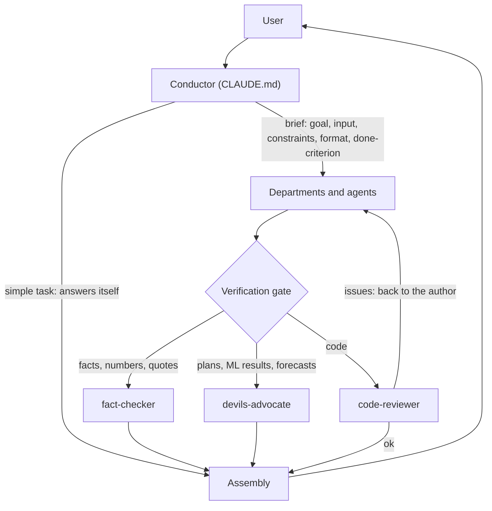
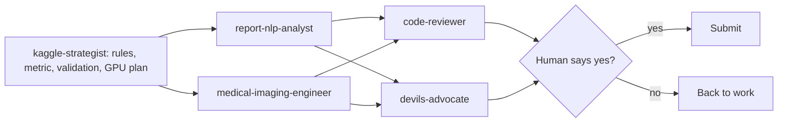

# Claude Agent Team: a conductor and 18 sub-agents for Claude Code

[Русская версия](README.ru.md)

A multi-agent setup for Claude Code. One main Claude (the "conductor") gets a task, splits it, hands the pieces to specialist sub-agents, sends the important results through a separate checker, and returns one assembled answer.

I built it to see where orchestration actually breaks: what goes into a brief, when to run agents in parallel, who checks what. The case studies below are real runs, including the mistakes.

Note: the agent prompts are in Russian. This is my personal working system, not a framework. The structure carries over to any language.

## Architecture



`CLAUDE.md` is the conductor's rulebook. Claude Code reads it automatically. The core loop has six steps:

1. **Assess.** A simple task (one or two steps, one skill) is solved directly, with no agents.
2. **Split** into subtasks and pick an agent for each from the department table.
3. **Order.** Independent subtasks run in parallel. Dependent ones run in sequence, and each result is passed forward.
4. **Brief.** An agent does not see the conversation. Every brief has five parts: goal, input (files, links, facts), constraints, output format, and a "done" criterion.
5. **Verify.** Code goes to `code-reviewer`. Facts, numbers and quotes for publication go to `fact-checker`. Plans, decisions, ML conclusions and forecasts go to `devils-advocate`.
6. **Assemble.** The conductor merges results, resolves contradictions and returns the outcome, not a retelling of who did what.

Also in `CLAUDE.md`: a short list of shared rules (pick the fastest working method, check anything that may have changed before writing it, plain-language style) and the instruction not to call agents "for show".

## Agents

| Department | Agent | Role | Tools | Model |
|---|---|---|---|---|
| Recon | `researcher` | Finds current information on the web, returns a digest with sources | WebSearch, WebFetch, Read, Grep, Glob | sonnet |
| | `fact-checker` | Checks facts, numbers, dates, quotes and links in a finished text; does not rewrite | WebSearch, WebFetch, Read, Grep, Glob | sonnet |
| | `scout` | Looks only for what is new: GitHub releases, arXiv, Claude plugins and skills | WebSearch, WebFetch, Bash, Read, Write | sonnet |
| Development | `architect` | Designs structure, interfaces and steps before non-trivial code; writes no code | Read, Grep, Glob, WebSearch, WebFetch | opus |
| | `developer` | Writes and fixes code, runs it to check it works | Read, Write, Edit, Bash, Grep, Glob, NotebookEdit, WebSearch, WebFetch | sonnet |
| | `code-reviewer` | Reviews code with fresh eyes, ranks findings by severity; does not edit files | Read, Grep, Glob, Bash | sonnet |
| Data and ML | `data-analyst` | EDA, statistics, charts; every number comes from code | Read, Write, Edit, Bash, Grep, Glob, NotebookEdit | sonnet |
| | `ml-engineer` | Baseline first, honest validation, leak checks, FastAPI serving | Read, Write, Edit, Bash, Grep, Glob, NotebookEdit, WebSearch, WebFetch | sonnet |
| Design | `designer` | Ready HTML/CSS/SVG layouts, responsive, contrast-aware | Read, Write, Edit, Bash, Glob, WebSearch, WebFetch | sonnet |
| Text | `copywriter` | Posts, resumes, letters, project descriptions, in RU or EN | Read, Write, Edit, Glob, WebSearch, WebFetch | sonnet |
| | `editor` | Proofreading, structure, style, RU/EN translation | Read, Write, Edit, Glob | sonnet |
| Science and education | `scientist` | Math, physics, statistics, papers; checks derivations with code | Read, Write, Edit, Bash, Grep, Glob, NotebookEdit, WebSearch, WebFetch | opus |
| | `methodist` | Lesson plans, assignments, curricula | Read, Write, Edit, Bash, Glob, WebSearch, WebFetch | sonnet |
| Thought | `philosopher` | Concepts, arguments, ethics; shows positions instead of handing out a verdict | Read, WebSearch, WebFetch | opus |
| | `devils-advocate` | Stress-tests a plan or result, looks for leaks and untested assumptions | Read, Grep, Glob, Bash, WebSearch, WebFetch | opus |
| Competitions and medicine | `medical-imaging-engineer` | MRI/DICOM, preprocessing, 2D/2.5D/3D models, GPU memory and inference time | Read, Write, Edit, Bash, Grep, Glob, NotebookEdit, WebSearch, WebFetch | opus |
| | `report-nlp-analyst` | Multilingual radiology reports, label extraction, text as an extra signal | Read, Write, Edit, Bash, Grep, Glob, NotebookEdit, WebSearch, WebFetch | opus |
| | `kaggle-strategist` | Competition rules and metric, leak-free validation, GPU-hour plan, pre-submit checklist | Read, Write, Edit, Bash, Grep, Glob, WebSearch, WebFetch | sonnet |

Tool lists are deliberately narrow. The reviewer and the fact-checker have no Write or Edit tools (the reviewer keeps Bash to run tests). The architect and the philosopher have no Bash. Six agents run on opus (architect, scientist, philosopher, devils-advocate and the two medical specialists); the other twelve run on sonnet.

There are also three commands: `/news [topic] [period]` runs `scout` (three parallel calls if no topic is given) and merges the results into a short digest; `/publish-check` checks a project for secrets, personal data, licences and review status before it goes public; `/handoff` saves the state of the work to Claude Code memory before you switch windows or end a session.

## Typical pipelines

- **New code:** `architect` → `developer` → `code-reviewer` → `developer` fixes the findings
- **Article or post:** `researcher` → `copywriter` → `editor` → `fact-checker`
- **ML project:** `data-analyst` → `ml-engineer` → `devils-advocate`
- **What is new on a topic:** `scout` → `researcher` if it needs depth
- **Decision or plan:** `researcher` → `philosopher` or `scientist` → `devils-advocate`
- **Landing page or product:** `copywriter` + `designer` in parallel → `developer`
- **Kaggle medical competition:** shown below



## Case studies

**1. Preparing four repositories for publication (15 Oct 2026).** `researcher` collected the job-market data. Two `developer` agents prepared four repositories in parallel. Two `code-reviewer` agents checked them independently, then a `developer` fixed the findings. The review caught, before anything was published:

- In a market-forecast backtest, the exogenous policy rate at 3–4 quarter horizons was taken from the future. That is a leak, and it inflated the model's accuracy.
- A naive "last value" baseline beat the chosen model, and the README did not say so.
- Notebook metadata from Colab still held the author's name and Google userId.
- One repository's dataset had no license (Kaggle API: unknown). The CSV was removed and replaced with a download script and a synthetic fixture.
- In a RAG service, re-uploading a document duplicated chunks in the vector store.

**2. The conductor's own mistake.** An unverified number ended up in a brief to the copywriter. The conductor caught it and sent a correction to the agent before the text reached the user. Lesson: a brief is also a place where hallucinations enter. The conductor is a source of errors too, not only the agents.

**3. Kaggle RSNA Knee (MRI, code competition, 2026).** Pipeline: `kaggle-strategist` → `medical-imaging-engineer` + `report-nlp-analyst` → `code-reviewer` + `devils-advocate`. Before a new architecture was tried, `devils-advocate` set numeric go/stop rules in advance (minimum quality, required diversity from the current model, minimum blend gain), so GPU quota would not go to an experiment with no payoff. A human confirms every submission. Details and results will be added after the competition ends.

## Evolution: v1 → v2

The first version is kept in [`v1/`](v1/): 13 agents, commands `/team` and `/council`. What changed:

| | v1 | v2 |
|---|---|---|
| Agents | 13 in 8 departments | 18 in 8 departments |
| Verification | One generic `reviewer` for everything | Three checkers by failure type: code, facts, plans and results |
| Task sizing | Levels S / M / L / Council | One rule: simple tasks without agents, composite ones split and routed |
| Entry points | `/team <task>`, `/council <question>` | Plain text following `CLAUDE.md`; `/news` for fresh finds |
| Pipelines | None written down | Seven named pipelines |
| Briefs | "Put everything in the prompt" | Five required parts, including a "done" criterion |
| Roles | `data-scientist`, `frontend-developer`, `strategist`, `teacher` | `ml-engineer`, `architect`, `methodist`, plus a competition trio (`kaggle-strategist`, `medical-imaging-engineer`, `report-nlp-analyst`) |
| Shared rules | Inside the conductor's file | A separate block that applies to every agent and goes into briefs |

Why: one reviewer reads code, text and conclusions the same way, but the failures in practice differ in kind (a leak in code, a missing license, an unsupported number). So each checker got its own prompt and its own tools. The competition trio replaces a generic `data-scientist` with roles that know the MRI and Kaggle specifics. The `/council` idea (several independent opinions on a hard question) survives as the pipeline "decision or plan".

## Installation

1. Copy `CLAUDE.md` to the root of your project.
2. Copy `agents/` to `.claude/agents/` and `commands/` to `.claude/commands/`.
3. Or install globally: copy the same folders to `~/.claude/agents/` and `~/.claude/commands/`.
4. Start `claude` in the project and run `/agents` to confirm all 18 agents are listed.

Then give the conductor a task in plain text, or call an agent by name ("let code-reviewer check train.py"). `CLAUDE.md` and the agent prompts are in Russian, so the conductor answers in Russian. Change the language rule at the end of its "Rules" section (the last line before the shared team rules) if you want something else.

## Limitations and lessons learned

- **Sub-agents cannot call other agents.** Only the conductor orchestrates. Any "agent hands off to agent" idea has to go through it.
- **The sandbox blocks some steps.** Claude Code's sandbox refuses writes to `.git` and browser launches. A human does these through `!`.
- **Publishing and submitting need an explicit "yes".** This applies to publications and Kaggle submissions.
- **Each agent starts from zero.** Output quality depends on the brief. Check the brief for facts the way you check the output.
- **More agents cost more tokens.** Hence the rule "do not call agents for show": two agents where one is enough is lost time and money.
- **Independent review beats self-review.** Two reviewers working separately, then one fixer, found issues that the authors had not.
- **Numeric stop rules save compute.** Agree on "continue or stop" thresholds before the experiment, not after.
- **The conductor can skip its own gate.** Once it called four repos "ready" before any review; the review that followed found a backtest leak and personal metadata. Rule since then: nothing is called ready or offered for publishing until a checker has given a verdict.
- **Agents drift outside their task.** One cleaned caches in neighbouring folders, another wrote a duplicate script. Every brief now names the folder the agent may touch.
- **Tell agents about the environment.** Two agents lost time on `git init`, which the sandbox forbids. Environment limits are now part of the shared rules.
- **Rules nobody checks are wishes.** Notebook formatting rules existed, yet notebooks without outputs or explanations nearly passed. The reviewer brief now includes an explicit notebook-formatting check.

## Files

```
CLAUDE.md        conductor rules
agents/          18 agents (frontmatter: name, description, tools, model)
commands/        /news (fresh releases digest), /publish-check (pre-publication check:
                 secrets, personal metadata, data licences, review), /handoff (save state
                 to memory before switching sessions)
v1/              the first version: 13 agents, /team and /council, chat personalization
```

MIT License. Author: Anastasia Kalugina.
