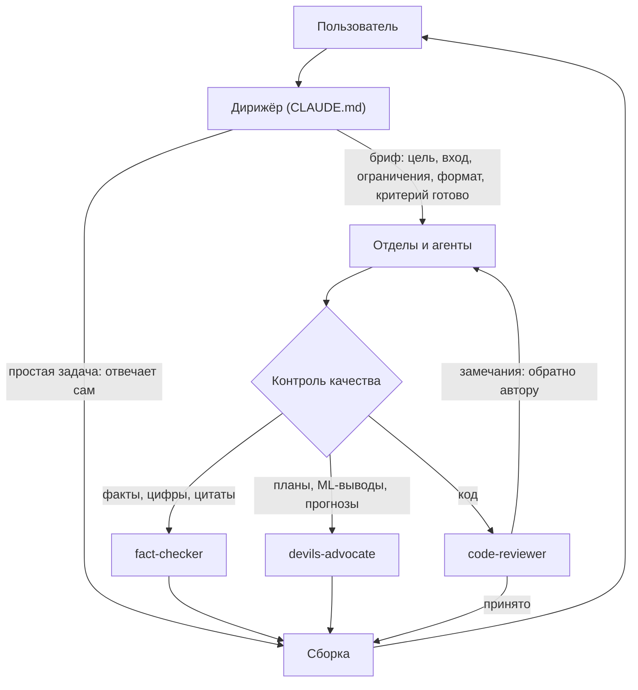
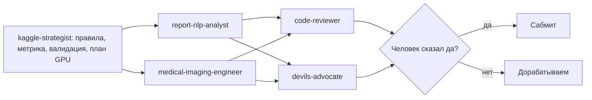

# Claude Agent Team: дирижёр и 18 субагентов для Claude Code

[English version](README.md)

Мультиагентная система для Claude Code. Главный Claude («дирижёр») получает задачу, разбивает её, раздаёт кусочки специалистам-субагентам, важное отправляет на проверку отдельному агенту и отдаёт один собранный результат.

Я сделала её, чтобы увидеть, где оркестрация ломается на практике: что класть в бриф, когда запускать агентов параллельно, кто что проверяет. Кейсы ниже — реальные запуски, вместе с ошибками.

Оговорка: промпты агентов написаны на русском. Это моя личная рабочая система, а не фреймворк. Структура переносится на любой язык.

## Архитектура



`CLAUDE.md` — правила дирижёра. Claude Code читает его автоматически. Основной цикл — шесть шагов:

1. **Оценить.** Простую задачу (один-два шага, один навык) дирижёр решает сам, без агентов.
2. **Разбить** на подзадачи и выбрать агента для каждой по таблице отделов.
3. **Порядок.** Независимое идёт параллельно. Зависимое — по очереди, результат передаётся дальше.
4. **Бриф.** Агент не видит разговор. В брифе пять частей: цель, входные данные (файлы, ссылки, факты), ограничения, формат результата, критерий «готово».
5. **Проверка.** Код — `code-reviewer`. Факты, цифры и цитаты для публикации — `fact-checker`. Планы, решения, ML-выводы и прогнозы — `devils-advocate`.
6. **Сборка.** Дирижёр сводит результаты, разрешает противоречия и отдаёт итог, а не пересказ того, кто что делал.

Там же короткий блок общих правил (выбирай самый быстрый рабочий способ, проверяй всё, что могло измениться, пиши простым языком) и требование не звать агентов «ради галочки».

## Агенты

| Отдел | Агент | Роль | Инструменты | Модель |
|---|---|---|---|---|
| Разведка | `researcher` | Ищет свежую информацию в сети, отдаёт выжимку с источниками | WebSearch, WebFetch, Read, Grep, Glob | sonnet |
| | `fact-checker` | Проверяет факты, цифры, даты, цитаты и ссылки в готовом тексте; не переписывает | WebSearch, WebFetch, Read, Grep, Glob | sonnet |
| | `scout` | Ищет только новинки: релизы на GitHub, arXiv, плагины и навыки Claude | WebSearch, WebFetch, Bash, Read, Write | sonnet |
| Разработка | `architect` | Проектирует структуру, интерфейсы и шаги до нетривиального кода; код не пишет | Read, Grep, Glob, WebSearch, WebFetch | opus |
| | `developer` | Пишет и исправляет код, запускает и проверяет | Read, Write, Edit, Bash, Grep, Glob, NotebookEdit, WebSearch, WebFetch | sonnet |
| | `code-reviewer` | Смотрит код свежим взглядом, замечания по степени тяжести; файлы не правит | Read, Grep, Glob, Bash | sonnet |
| Данные и ML | `data-analyst` | EDA, статистика, графики; каждое число — из кода | Read, Write, Edit, Bash, Grep, Glob, NotebookEdit | sonnet |
| | `ml-engineer` | Сначала бейзлайн, честная валидация, проверка утечек, сервинг на FastAPI | Read, Write, Edit, Bash, Grep, Glob, NotebookEdit, WebSearch, WebFetch | sonnet |
| Дизайн | `designer` | Готовые HTML/CSS/SVG-макеты, адаптивные, с учётом контраста | Read, Write, Edit, Bash, Glob, WebSearch, WebFetch | sonnet |
| Тексты | `copywriter` | Посты, резюме, письма, описания проектов, RU и EN | Read, Write, Edit, Glob, WebSearch, WebFetch | sonnet |
| | `editor` | Вычитка, структура, стиль, перевод RU/EN | Read, Write, Edit, Glob | sonnet |
| Наука и образование | `scientist` | Математика, физика, статистика, статьи; выводы проверяет кодом | Read, Write, Edit, Bash, Grep, Glob, NotebookEdit, WebSearch, WebFetch | opus |
| | `methodist` | Планы уроков, задания, учебные программы | Read, Write, Edit, Bash, Glob, WebSearch, WebFetch | sonnet |
| Мысль | `philosopher` | Понятия, аргументы, этика; показывает позиции, а не выдаёт вердикт | Read, WebSearch, WebFetch | opus |
| | `devils-advocate` | Стресс-тест плана или результата, ищет утечки и непроверенные допущения | Read, Grep, Glob, Bash, WebSearch, WebFetch | opus |
| Соревнования и медицина | `medical-imaging-engineer` | МРТ/DICOM, предобработка, 2D/2.5D/3D-модели, память GPU и время инференса | Read, Write, Edit, Bash, Grep, Glob, NotebookEdit, WebSearch, WebFetch | opus |
| | `report-nlp-analyst` | Многоязычные радиологические заключения, извлечение меток, текст как доп. сигнал | Read, Write, Edit, Bash, Grep, Glob, NotebookEdit, WebSearch, WebFetch | opus |
| | `kaggle-strategist` | Правила и метрика конкурса, валидация без утечек, план GPU-часов, чек-лист перед сабмитом | Read, Write, Edit, Bash, Grep, Glob, WebSearch, WebFetch | sonnet |

Наборы инструментов узкие намеренно. У ревьюера и фактчекера нет инструментов Write и Edit (у ревьюера есть Bash, чтобы запускать тесты). У архитектора и философа нет Bash. Шесть агентов работают на opus (architect, scientist, philosopher, devils-advocate и два медицинских специалиста), остальные двенадцать — на sonnet.

Есть и три команды: `/news [тема] [период]` запускает `scout` (без темы — три параллельных вызова) и сводит результат в короткий дайджест; `/publish-check` проверяет проект перед публикацией на секреты, личные данные, лицензии и статус ревью; `/handoff` сохраняет состояние работы в память Claude Code перед переходом в другое окно или концом сессии.

## Типовые конвейеры

- **Новый код:** `architect` → `developer` → `code-reviewer` → `developer` правит замечания
- **Статья / пост:** `researcher` → `copywriter` → `editor` → `fact-checker`
- **ML-проект:** `data-analyst` → `ml-engineer` → `devils-advocate`
- **Что нового по теме:** `scout` → `researcher`, если нужно углубиться
- **Решение / план:** `researcher` → `philosopher` или `scientist` → `devils-advocate`
- **Лендинг / продукт:** `copywriter` + `designer` параллельно → `developer`
- **Kaggle, медицина:** схема ниже



## Кейсы

**1. Подготовка четырёх репозиториев к публикации (15.10.2026).** `researcher` собрал данные по рынку труда. Два `developer` параллельно подготовили четыре репозитория. Два `code-reviewer` проверили их независимо, затем `developer` исправил замечания. Ревью поймало до публикации:

- В бэктесте прогноза рынка экзогенная ключевая ставка на горизонтах 3–4 квартала бралась из будущего. Это утечка, из-за неё точность модели была завышена.
- Наивный бейзлайн «последнее значение» обыгрывал выбранную модель, а в README этого не было.
- В метаданных ноутбука из Colab остались имя автора и Google userId.
- У датасета в одном репозитории не было лицензии (Kaggle API: unknown). CSV убрали и заменили скриптом загрузки и синтетической фикстурой.
- В RAG-сервисе повторная загрузка документа дублировала чанки в векторной базе.

**2. Ошибка самого дирижёра.** В бриф копирайтеру попало непроверенное число. Дирижёр заметил это и отправил агенту исправление до того, как текст ушёл пользователю. Вывод: бриф — тоже место, где возникают галлюцинации. Источник ошибок не только агенты, но и дирижёр.

**3. Kaggle RSNA Knee (МРТ, код-соревнование, 2026).** Конвейер: `kaggle-strategist` → `medical-imaging-engineer` + `report-nlp-analyst` → `code-reviewer` + `devils-advocate`. Перед экспериментом с новой архитектурой `devils-advocate` заранее задал численные правила «продолжать или остановиться» (минимальное качество, нужное отличие от текущей модели, минимальный прирост бленда), чтобы не жечь GPU-квоту на эксперимент без отдачи. Каждую отправку сабмита подтверждает человек. Подробности и результаты добавлю после окончания соревнования.

## Эволюция v1 → v2

Первая версия лежит в [`v1/`](v1/): 13 агентов, команды `/team` и `/council`. Что изменилось:

| | v1 | v2 |
|---|---|---|
| Агенты | 13 в 8 отделах | 18 в 8 отделах |
| Проверка | Один общий `reviewer` на всё | Три проверяющих по типу ошибки: код, факты, планы и результаты |
| Оценка задачи | Уровни S / M / L / Совет | Одно правило: простое без агентов, составное разбить и раздать |
| Входы | `/team <задача>`, `/council <вопрос>` | Обычный текст по правилам `CLAUDE.md`; `/news` для новинок |
| Конвейеры | Не описаны | Семь именованных конвейеров |
| Бриф | «Клади в промпт всё» | Пять обязательных частей, включая критерий «готово» |
| Роли | `data-scientist`, `frontend-developer`, `strategist`, `teacher` | `ml-engineer`, `architect`, `methodist` и тройка для соревнований (`kaggle-strategist`, `medical-imaging-engineer`, `report-nlp-analyst`) |
| Общие правила | Внутри файла дирижёра | Отдельный блок для всех агентов, который идёт в брифы |

Почему: один ревьюер читает код, текст и выводы одинаково, а ошибки на практике разные по природе (утечка в коде, нет лицензии, число без источника). Поэтому у каждого проверяющего свой промпт и свои инструменты. Тройка для соревнований заменяет общего `data-scientist` ролями, которые знают специфику МРТ и Kaggle. Идея `/council` (несколько независимых мнений по сложному вопросу) осталась в конвейере «решение / план».

## Установка

1. Скопируйте `CLAUDE.md` в корень проекта.
2. Скопируйте `agents/` в `.claude/agents/`, а `commands/` в `.claude/commands/`.
3. Или поставьте глобально: те же папки в `~/.claude/agents/` и `~/.claude/commands/`.
4. Запустите `claude` в проекте и введите `/agents`, чтобы убедиться, что все 18 агентов видны.

Дальше ставьте задачу обычным текстом или зовите агента по имени («пусть code-reviewer проверит train.py»). `CLAUDE.md` и промпты агентов написаны на русском, поэтому дирижёр отвечает по-русски. Чтобы сменить язык, поправьте правило о языке в конце раздела «Правила» (последняя строка перед общими правилами команды).

## Ограничения и уроки

- **Субагенты не могут вызывать других агентов.** Оркестрирует только дирижёр. Любая идея «агент передаёт агенту» идёт через него.
- **Песочница блокирует часть шагов.** Claude Code не даёт писать в `.git` и запускать браузер. Такие шаги человек выполняет через `!`.
- **Публикации и сабмиты — только после явного «да».** Это касается публикаций и отправок на Kaggle.
- **Каждый агент стартует с нуля.** Качество результата зависит от брифа. Бриф проверяйте на факты так же, как результат.
- **Больше агентов — больше токенов.** Отсюда правило «не звать агентов ради галочки»: два агента там, где хватает одного, — потеря времени и денег.
- **Независимая проверка лучше самопроверки.** Два ревьюера по отдельности и один исправляющий нашли то, что авторы не заметили.
- **Численные правила остановки экономят вычисления.** Пороги «продолжать или остановиться» договариваются до эксперимента, а не после.
- **Дирижёр может пропустить собственную проверку.** Однажды он назвал четыре репозитория «готовыми» до ревью, а ревью потом нашло утечку в бэктесте и личные метаданные. С тех пор ничего не называется готовым и не предлагается к публикации, пока проверяющий не дал вердикт.
- **Агенты выходят за рамки задачи.** Один почистил кэши в соседних папках, другой сделал дубль скрипта. Теперь в каждом брифе указана папка, в которой агент работает.
- **Агентам надо знать про среду.** Двое потратили время на `git init`, который песочница запрещает. Ограничения среды теперь в общих правилах.
- **Правило, которое никто не проверяет, — пожелание.** Правила оформления ноутбуков были, но ноутбуки без выводов и пояснений почти прошли. В бриф ревьюера добавлена явная проверка оформления ноутбуков.

## Файлы

```
CLAUDE.md        правила дирижёра
agents/          18 агентов (frontmatter: name, description, tools, model)
commands/        /news (дайджест новинок), /publish-check (проверка перед публикацией:
                 секреты, личные метаданные, лицензии данных, ревью), /handoff (сохранить
                 состояние в память перед сменой сессии)
v1/              первая версия: 13 агентов, /team и /council, настройка чата
```

Лицензия MIT. Автор: Anastasia Kalugina.
